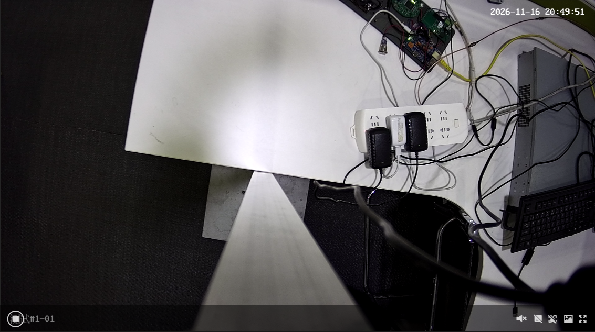
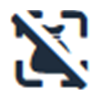
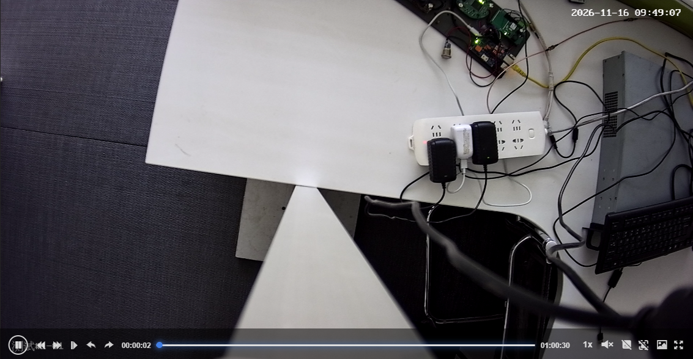

# 视频播放器使用说明

- 文档版本：V1.0
- 更新日期：2026 年 11 月

## 1. 实时预览

*图 1 实时预览*

**视频进度控制**

| 图标 | 按钮 / 控件 | 作用 | 说明 |
| --- | --- | --- | --- |
|  | 停止播放 | 停止实时画面 | 停止后画面关闭 |

**播放器控制**

| 图标 | 按钮 / 控件 | 作用 | 说明 |
| --- | --- | --- | --- |
|  | 音量 / 静音 | 调整声音大小或静音 | 点击图标切换静音，展开后可拖动滑块调整音量 |
|  | 目标（开启） | 画面显示智能分析目标框 | 与「关闭」切换 |
|  | 目标（关闭） | 画面不显示目标框 | 与「开启」切换 |
|  | 字幕（开启） | 画面显示字幕 | 与「关闭」切换；该画面有字幕时才可用 |
|  | 字幕（关闭） | 画面不显示字幕 | 与「开启」切换；该画面有字幕时才可用 |
|  | 截图 | 截取当前画面并保存为图片 | 图片保存到浏览器默认下载位置 |
|  | 全屏 | 全屏显示当前画面 | 按 Esc 或 F11 退出全屏 |

## 2. 录像回放

*图 2 录像回放*

**视频进度控制**

| 图标 | 按钮 / 控件 | 作用 | 说明 |
| --- | --- | --- | --- |
|  | 播放 | 开始或继续播放录像 | 与「暂停」切换 |
|  | 暂停 | 暂停录像 | 与「播放」切换 |
|  | 慢放 | 降低播放速度 | 每点一次降低一档；最低 1/16x，再点一次恢复 1x |
|  | 快进 | 提高播放速度 | 每点一次提高一档；最高 8x，再点一次恢复 1x |
|  | 单帧进 | 向前播放一帧 | 暂停后使用，便于逐帧查看 |
|  | 退 30 秒 | 把播放位置向前倒回 30 秒 | — |
|  | 进 30 秒 | 把播放位置向后跳过 30 秒 | — |
|  | 进度条 | 直接定位到录像的任意时间 | 拖动进度条上的圆点调整位置 |
|  | 当前时间 / 总时长 | 显示已播放时间和录像总长度 | 格式为 时:分:秒 |
| 1x | 倍速 | 显示并选择当前播放速度 | 鼠标移到倍速数字上弹出列表，可选择 8x～1/16x；与慢放、快进同步变化 |

> **说明：** 慢放、快进和倍速是联动的：点一次慢放或快进切换一档，倍速数字同步变化；到达 8x 或 1/16x 后再点一次，恢复 1x。也可以把鼠标移到倍速数字上，在弹出的列表中选择 8x、4x、2x、1x、1/2x、1/4x、1/8x、1/16x。

**播放器控制**

| 图标 | 按钮 / 控件 | 作用 | 说明 |
| --- | --- | --- | --- |
|  | 音量 / 静音 | 调整声音大小或静音 | 点击图标切换静音，展开后可拖动滑块调整音量 |
|  | 目标（开启） | 画面显示智能分析目标框 | 与「关闭」切换 |
|  | 目标（关闭） | 画面不显示目标框 | 与「开启」切换 |
|  | 字幕（开启） | 画面显示字幕 | 与「关闭」切换；该录像有字幕时才可用 |
|  | 字幕（关闭） | 画面不显示字幕 | 与「开启」切换；该录像有字幕时才可用 |
|  | 截图 | 截取当前画面并保存为图片 | 图片保存到浏览器默认下载位置 |
|  | 全屏 | 全屏显示当前画面 | 按 Esc 或 F11 退出全屏 |

## 3. 通用操作与提示

- 控制条默认隐藏，鼠标移到画面底部的控制条区域时显示，移出后隐藏。
- 多画面播放时，每个画面各自独立控制；要操作某一路，先单击该画面选中，再使用画面下方的控制条。
- 全屏后按 **Esc** 或 **F11** 退出。
- 截图保存的是点击瞬间的画面，按浏览器默认下载位置保存。
- 浏览器可能限制自动播放声音；没有声音时，先点击一下画面，再调整音量。

> **说明：** 不同项目、不同页面的播放器外观可能略有差异，但播放、暂停、音量、截图、全屏等常用按钮的作用一致。

---

*视频播放器使用说明 V1.0*
