# 惠南水厂智能安防平台

**使用说明**

- 文档版本：V1.6
- 适用对象：系统使用人员
- 更新日期：2026 年 11 月

## 目录

- 一、使用前的准备
  - [1.1 浏览器与显示](#sec-1-1)
  - [1.2 账号权限说明](#sec-1-2)
- 二、登录与退出
  - [2.1 登录页面](#sec-2-1)
  - [2.2 顶部功能栏](#sec-2-2)
  - [2.3 退出登录](#sec-2-3)
- 三、地图主页
  - [3.1 设备运行状态](#sec-3-1)
    - [3.1.1 设备列表窗口](#sec-3-1-1)
  - [3.2 报警列表](#sec-3-2)
    - [3.2.1 报警记录窗口](#sec-3-2-1)
      - [3.2.1.1 报警记录](#sec-3-2-1-1)
      - [3.2.1.2 出入口记录](#sec-3-2-1-2)
  - [3.3 三维地图](#sec-3-3)
    - [3.3.1 三维地图操作](#sec-3-3-1)
    - [3.3.2 地图点位说明](#sec-3-3-2)
    - [3.3.3 三维地图使用说明](#sec-3-3-3)
      - [3.3.3.1 地图点位](#sec-3-3-3-1)
      - [3.3.3.2 建筑列表](#sec-3-3-3-2)
      - [3.3.3.3 渲染模式](#sec-3-3-3-3)
      - [3.3.3.4 区域联动](#sec-3-3-3-4)
      - [3.3.3.5 区域查找](#sec-3-3-3-5)
      - [3.3.3.6 查找结果](#sec-3-3-3-6)
    - [3.3.4 点位统计面板](#sec-3-3-4)
      - [3.3.4.1 点位信息列表窗口](#sec-3-3-4-1)
    - [3.3.5 点位分组面板](#sec-3-3-5)
      - [3.3.5.1 点位名称同步（仅管理员）](#sec-3-3-5-1)
  - [3.4 报警弹窗](#sec-3-4)
  - [3.5 视频窗口](#sec-3-5)
- 四、视频播放
  - [4.1 播放器](#sec-4-1)
  - [4.2 视频预览（需要视频预览权限）](#sec-4-2)
    - [4.2.1「摄像机」列表面板](#sec-4-2-1)
    - [4.2.2 视频组](#sec-4-2-2)
  - [4.3 视频回放（需要视频回放权限）](#sec-4-3)
- 五、视频下载（需要视频下载权限）
  - [5.1 下载任务状态说明](#sec-5-1)
  - [5.2 下载文件名称](#sec-5-2)
- 六、设置
  - [6.1 系统设置](#sec-6-1)
  - [6.2 地图布控（仅管理员）](#sec-6-2)
    - [6.2.1 操作步骤](#sec-6-2-1)
    - [6.2.2 设备信息](#sec-6-2-2)
    - [6.2.3 三维地图](#sec-6-2-3)
  - [6.3 区域资源设置（仅管理员）](#sec-6-3)
    - [6.3.1 区域资源](#sec-6-3-1)
    - [6.3.2 摄像机列表](#sec-6-3-2)
    - [6.3.3 摄像机分配](#sec-6-3-3)
- 七、常见问题
  - [登录提示「用户名或密码错误」？](#faq-1)
  - [看不到「下载」「视频回放」入口或按钮不可操作？](#faq-2)
  - [有摄像机名称，但无法播放视频？](#faq-3)
  - [地图上看不到某个设备点位？](#faq-4)
  - [三维地图加载慢、无法显示或显示异常？](#faq-5)
  - [页面提示「实时消息服务连接失败」？](#faq-6)
  - [下载任务一直「排队中」？](#faq-7)

## 一、使用前的准备

### 1.1 浏览器与显示

- 建议使用 Chrome（谷歌浏览器）或 Edge（微软浏览器），不建议使用 IE 浏览器。
- 建议屏幕分辨率 1920×1080 及以上，浏览器全屏使用效果最佳。
- 三维地图首次加载需要下载模型，等待时间与网络有关，请耐心等待加载完成。

### 1.2 账号权限说明

账号能使用哪些功能、能看到哪些摄像机，由管理员在权限组中配置。权限分为两类：

- **功能权限：** 视频预览、视频回放、视频下载、报警设置。
- **视频权限：** 账号只能看到有权限的摄像机。

**各功能需要的权限：**

| 功能 | 需要的权限 |
| --- | --- |
| 视频预览 | 视频预览权限 |
| 视频回放 | 视频回放权限 |
| 视频下载 | 视频下载权限 |
| 报警复位 | 报警设置权限 |
| 地图布控、区域资源设置 | 仅系统管理员 |

**不同权限下界面的具体变化：**

| 权限 | 拥有该权限时 |
| --- | --- |
| 视频预览 | 可查看摄像机的实时画面；发生报警时弹出报警弹窗 |
| 视频回放 | 可查看摄像机的历史录像 |
| 视频下载 | 可下载摄像机录像，并可设置同时下载数量 |
| 报警设置 | 可复位报警器、传感器、门禁等点位的报警状态 |

> **说明：** 按钮可用但没有反应时，通常是设备离线或未选择目标。找不到功能入口时，请先确认账号权限，需要开通时联系系统管理员。

## 二、登录与退出

### 2.1 登录页面

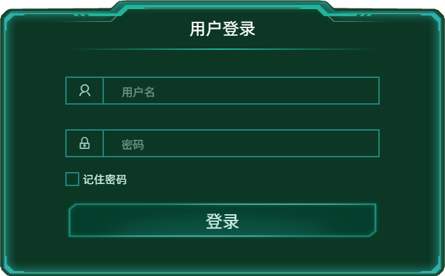

*图 1 登录页面*

| 图标 | 控件 | 作用 | 说明 |
| --- | --- | --- | --- |
| 👤 | 用户名输入框 | 输入登录账号 | 由管理员分配 |
| 🔒 | 密码输入框 | 输入登录密码 | — |
| ☐ | 记住密码 | 勾选后，下次打开登录页自动填入账号和密码 | 公共电脑请勿勾选； 取消勾选并登录后会清除已保存的账号密码 |

登录结果：账号或密码为空时会提示“请输入账号/密码”；账号密码错误时提示“用户名或密码错误”；登录成功直接进入地图主页。

### 2.2 顶部功能栏

登录后页面顶部显示系统名称、日期时间，以及右侧的功能图标：

- 地图 🏠：返回三维地图主页。
- 视频 🎥：进入视频播放页。
- 下载 ⬇️：打开视频下载页面（需要视频下载权限）。
- 设置 ⚙️：进入系统设置页面。
- 帮助 ❓：在新页面打开本使用说明。
- 账号 👤：打开账号菜单，查看当前账号、退出登录。

### 2.3 退出登录

**操作步骤**

1. 点击顶部「账号」图标 👤。
2. 在弹出的菜单中点击「退出登录」。
3. 系统返回登录页面，需要重新输入账号密码。

## 三、地图主页

地图主页是系统总览页面：左侧是设备运行状态和报警列表，其余区域是厂区三维地图。

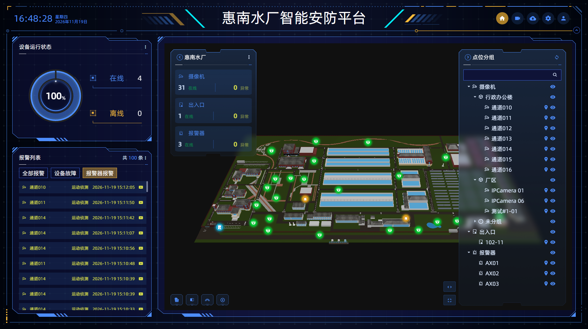

*图 2 地图主页总览*

### 3.1 设备运行状态

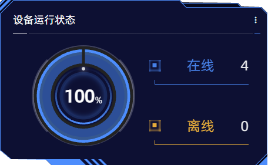

*图 3 设备运行状态*

**快捷操作**

| 图标 | 控件 | 作用 | 说明 |
| --- | --- | --- | --- |
| ⋮ | 查看全部 | 打开全部设备列表 | 卡片右上角默认显示「⋮」图标，鼠标移到该区域时显示「查看全部」 |

**运行概况**

| 控件 | 作用 | 说明 |
| --- | --- | --- |
| 环形图 | 直观显示在线/离线设备占比 | 中间显示在线设备占比 |
| 在线 | 打开在线设备列表 | 点击后，弹窗中只显示在线设备 |
| 离线 | 打开离线设备列表 | 点击后，弹窗中只显示离线设备 |

#### 3.1.1 设备列表窗口

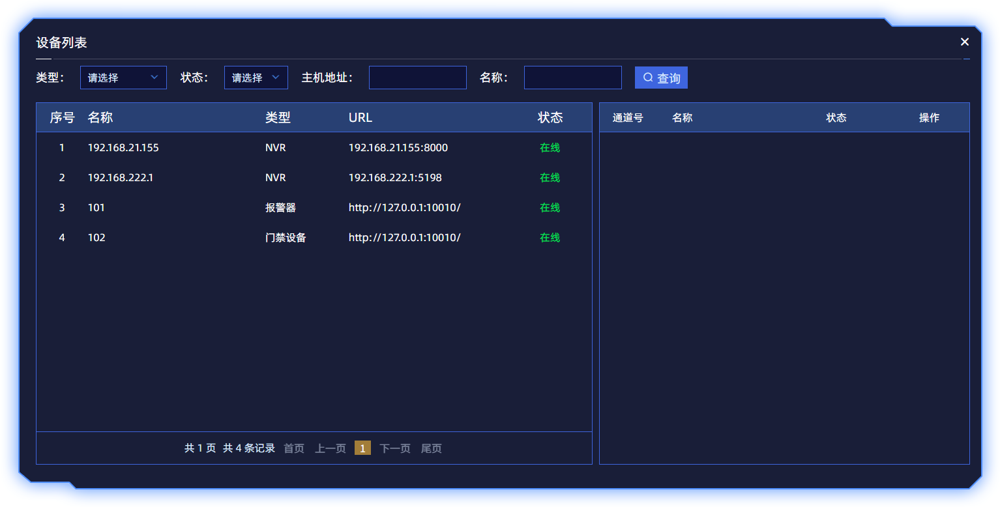

*图 4 设备列表窗口*

单击左侧设备，右侧显示该设备关联的内容：

| 图标 | 设备 | 下面显示的内容 |
| --- | --- | --- |
| 🎥 | IPC | 这台摄像机的画面 |
| 🖥️ | NVR | 录像机管理的摄像机画面 |
| 🔔 | 报警主机 | 报警器 |
| 🚪 | 门禁主机 | 门禁 |
| 📡 | 传感器设备 | 传感器 |

**筛选条件**

| 控件 | 作用 | 说明 |
| --- | --- | --- |
| 类型 | 按设备类型筛选 | 选项为系统支持的设备类型，分视频设备（如硬盘录像机、摄像机）和 DB31 设备（如报警主机、门禁主机、传感器），具体名称以现场配置为准； 不选择表示全部类型 |
| 状态 | 按在线/离线筛选 | 选项为「在线」「离线」； 不选择表示全部状态 |
| 设备地址输入框 | 按设备地址查询 | 输入完整或部分地址 |
| 名称输入框 | 按设备名称查询 | 支持部分名称 |

**设备详情**

| 图标 | 控件 | 作用 | 说明 |
| --- | --- | --- | --- |
|  | 设备状态列 | 显示在线/离线 | ● 在线，● 离线 |
| ▶️ | 视频预览 | 播放该摄像机的实时视频 | 摄像机离线时不可播放 |

### 3.2 报警列表

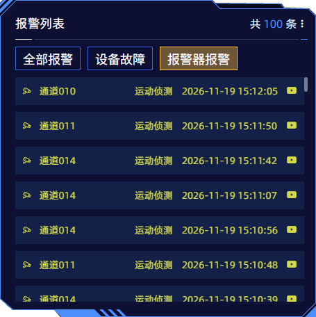

*图 5 报警列表*

主页报警列表最多显示最近 100 条报警（最近一个月内，按时间倒序）；需要查看更多记录时，请点击「查看全部报警」打开报警记录窗口。

**快捷操作**

| 图标 | 控件 | 作用 | 说明 |
| --- | --- | --- | --- |
|  | 全部报警 | 显示所有类型的报警 | — |
|  | 设备故障 | 只显示设备故障类报警 | 如离线、故障等 |
|  | 报警器报警 | 只显示报警器触发的报警 | 默认选中； 包括报警器、门禁、传感器 |
| ⋮ | 查看全部报警 | 打开完整的报警记录窗口 | 卡片右上角默认显示条目数和「⋮」图标，鼠标移到该区域时显示「查看全部报警」 |

**报警记录**

| 图标 | 控件 | 作用 | 说明 |
| --- | --- | --- | --- |
|  | 报警记录详情 | 设备类型、设备名称、报警类型、报警时间 | 鼠标悬停显示详细信息 |
| ▶️ | 视频回放 | 回放该报警关联的视频 | 需回放权限 |

#### 3.2.1 报警记录窗口

**3.2.1.1 报警记录**

显示设备的报警、故障记录。

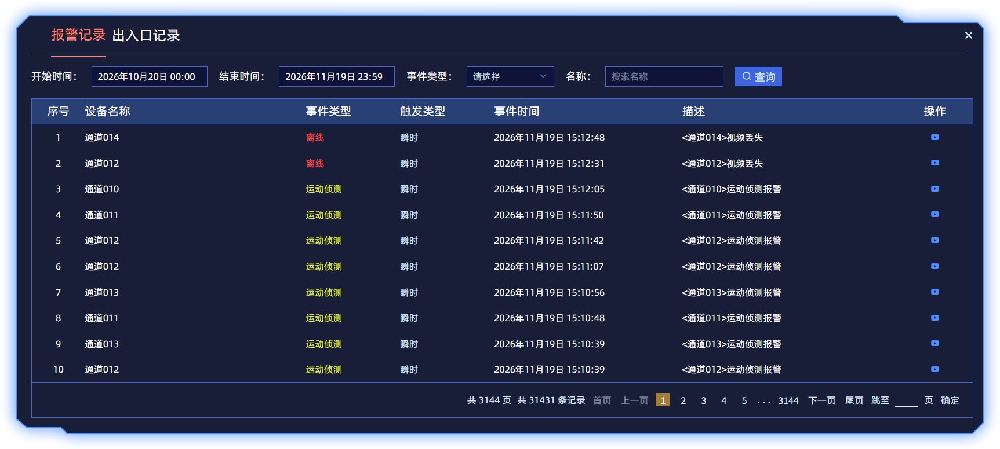

*图 6 报警记录*

**操作**

| 图标 | 控件 | 作用 | 说明 |
| --- | --- | --- | --- |
| ▶️ | 视频回放 | 回放该记录关联的视频 | 只有同时具备回放权限并有关联视频时才显示按钮 |

**筛选条件**

| 控件 | 作用 | 说明 |
| --- | --- | --- |
| 开始时间 / 结束时间 | 按时间段筛选报警记录 | 点击输入框选择日期和时间，精确到小时 |
| 事件类型 | 按报警事件类型筛选 | 选项为：上线、离线、运动侦测、报警器报警； 不选择表示全部类型 |
| 名称输入框 | 按设备名称搜索 | 支持部分名称 |

**3.2.1.2 出入口记录**

显示出入口/门禁的进出记录。

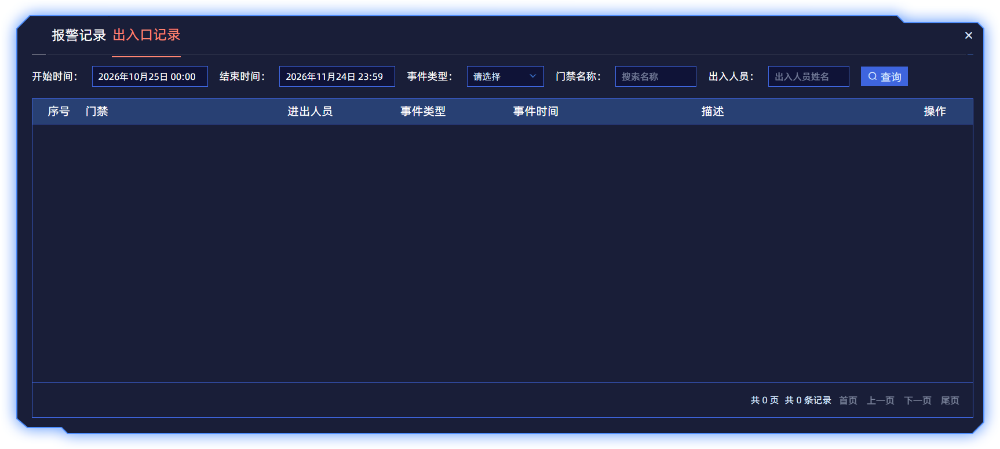

*图 6-1 出入口记录*

**操作**

| 图标 | 控件 | 作用 | 说明 |
| --- | --- | --- | --- |
| ▶️ | 视频回放 | 回放该记录关联的视频 | 需要回放权限 |

**筛选条件**

| 控件 | 作用 | 说明 |
| --- | --- | --- |
| 开始时间 / 结束时间 | 按时间段筛选出入口记录 | 点击输入框选择日期和时间，精确到小时 |
| 事件类型 | 按门禁事件类型筛选 | 选项为：人员进入、人员离开； 不选择表示全部类型 |
| 门禁名称输入框 | 按门禁名称搜索 | 支持部分名称 |
| 出入人员输入框 | 按进出人员姓名搜索 | 支持部分姓名 |

### 3.3 三维地图

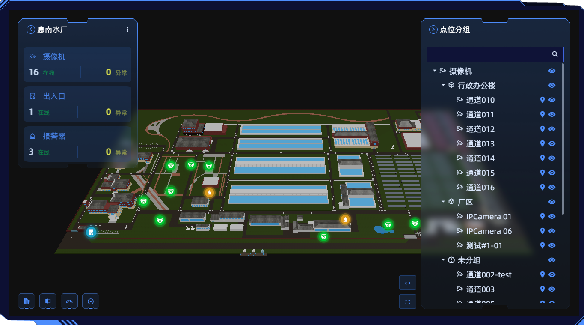

*图 7 三维地图总览*

#### 3.3.1 三维地图操作

| 操作 | 作用 | 说明 |
| --- | --- | --- |
| 按住鼠标左键拖动 | 平移地图 | 上下左右移动视角 |
| 按住鼠标右键拖动 | 旋转地图 | 调整观察角度 |
| 滚动鼠标滚轮 | 放大 / 缩小地图 | — |
| 单击建筑 | 选中并聚焦该建筑 | — |
| 双击建筑 | 展开建筑，显示楼层按钮 | — |
| 单击空白区域 | 取消当前选中 | — |

**展开与全屏**

| 图标 | 控件 | 作用 | 说明 |
| --- | --- | --- | --- |
| ↕️ | 展开 | 放大地图区域，左右面板收起 | — |
| ↕️ | 还原（展开后） | 恢复地图区域和左右面板 | — |
| ⛶ | 全屏 | 全屏显示地图 | — |
| ⛶ | 还原（全屏后） | 退出全屏 | 按 Esc 或 F11 也可以退出 |

#### 3.3.2 地图点位说明

地图上的每一个图标都是一个点位，对应摄像机、报警器、传感器、出入口等设备。点位用于在三维地图上快速找到设备、查看设备状态，并对设备执行预览、复位等操作。

异常点位显示为 ● 异常。具体使用见 3.3.3 三维地图使用说明。

系统中点位使用的图标如下：

-  **摄像机**：双击播放实时视频（需要视频预览权限）
-  **报警器**：显示报警状态；双击复位报警（需要报警设置权限）
-  **传感器**：显示设备状态；双击复位报警（需要报警设置权限）
-  **出入口**：显示门禁设备状态；双击复位报警（需要报警设置权限）

#### 3.3.3 三维地图使用说明

三维地图的操作入口在左下角的按钮栏和地图内的点位上，先说明地图点位的交互，再按左下角按钮从左到右说明。

##### 3.3.3.1 地图点位

- 地图上的图标代表摄像机、报警器、传感器、出入口等设备点位。
- 异常点位显示为 ● 异常。
- 双击摄像机：播放实时视频（需要视频预览权限）。
- 双击报警器、传感器、门禁、出入口：复位报警状态（需要报警设置权限；离线点位不可复位）。

##### 3.3.3.2 建筑列表

点击左下角第一个「建筑列表」 🏢，地图上会显示厂区内所有建筑名称；再点一次收起列表。

- 单击建筑名称：定位并聚焦该建筑。
- 双击建筑名称：展开建筑，显示楼层按钮。
- 也可以直接在地图上单击建筑定位、双击建筑展开。

展开建筑后，左下角显示楼层按钮和「返回」：

- 楼层按钮：切换楼层，当前楼层高亮。
- 返回：从楼层回到厂区视角。
- 楼栋名称：点击取消当前楼层选中，回到整栋楼的全局视角。

##### 3.3.3.3 渲染模式

点击「渲染模式」 🌓，在「实体」和「透视」两种显示模式之间切换。

进入楼层后不能切换渲染模式。

##### 3.3.3.4 区域联动

区域联动用于查找能看到指定位置的摄像机，适合事发后快速找到附近的摄像机。

**操作步骤**

1. 点击「区域联动」 👁️，进入联动状态，按钮高亮。
2. 在地图上单击关注的位置，系统列出能看到该位置的摄像机。
3. 在查找结果中，点单个摄像机的播放按钮 ▶️ 预览该摄像机，或点「全部播放」 📷 同时播放。
4. 单击鼠标右键（不拖动）退出；再点一次「区域联动」也可以退出。

##### 3.3.3.5 区域查找

区域查找用于查找指定位置附近的点位，适合按距离查找摄像机和其他设备。

**操作步骤**

1. 点击「区域查找」 ◎，进入查找状态，按钮高亮。
2. 拖动下方滑块调整搜索半径（1～100 米）。
3. 在地图上单击需要查找的位置，系统搜索该位置附近的点位。
4. 在查找结果中，点单个摄像机的播放按钮 ▶️ 预览该摄像机，或点「全部播放」 📷 同时播放。
5. 单击鼠标右键（不拖动）退出；再点一次「区域查找」也可以退出。

##### 3.3.3.6 查找结果

区域查找或区域联动完成后，地图上会弹出查找结果：

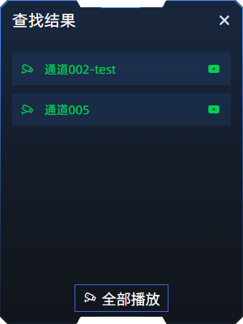

*图 10 区域查找与查找结果*

| 图标 | 控件 | 作用 | 说明 |
| --- | --- | --- | --- |
| ▶️ | 播放视频 | 播放该点位的视频 | 仅摄像机可播放 |
| 📷 | 全部播放 | 同时播放列表内所有摄像机 | 列表中有摄像机时才可播放 |

#### 3.3.4 点位统计面板

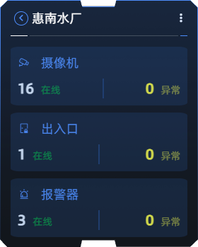

*图 8 点位统计面板*

**快捷操作**

| 图标 | 控件 | 作用 | 说明 |
| --- | --- | --- | --- |
| ◯◂ | 折叠箭头 | 收起/展开统计面板 | 收起后只保留箭头按钮 |
| ⋮ | 查看全部 | 打开全部类型的点位信息列表 | 面板右上角默认显示「⋮」图标，鼠标移到该区域时显示「查看全部」 |

**点位统计**

| 控件 | 作用 | 说明 |
| --- | --- | --- |
| 类型名称 | 打开该类型的点位信息列表 | 包括摄像机、报警器、传感器、出入口； 点击后，列表显示该类型全部点位 |
| 在线 | 打开该类型的在线点位列表 | 点击后，列表只显示在线点位 |
| 异常 | 打开该类型的异常点位列表 | 点击后，列表只显示异常点位； 数量为离线 + 报警的点位数 |

##### 3.3.4.1 点位信息列表窗口

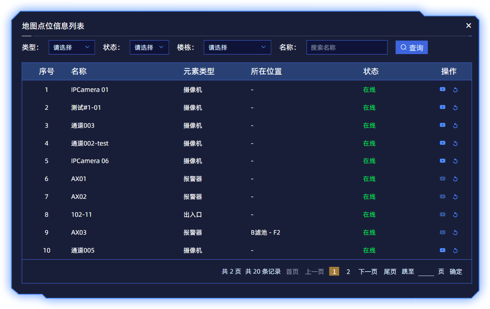

*图 11 点位信息列表窗口*

**点位状态：**● 在线，● 异常。

**筛选条件**

| 控件 | 作用 | 说明 |
| --- | --- | --- |
| 类型 | 按点位类型筛选 | 如摄像机、报警器、传感器、出入口 |
| 状态 | 按点位状态筛选 | 选项为「在线」「异常」； 不选择表示全部状态 |
| 楼栋 | 只看指定楼栋内的点位 | 不选择表示全部 |
| 名称输入框 | 按点位名称搜索 | 支持部分名称 |

**点位详情**

| 图标 | 控件 | 作用 | 说明 |
| --- | --- | --- | --- |
| ▶️ | 视频预览 | 播放该点位视频 | 只有在线摄像机可播放 |
| ↻ | 重置状态 | 复位该点位的报警状态 | 复位后主页数据同步刷新； 离线点位不可重置（需要报警设置权限） |

#### 3.3.5 点位分组面板

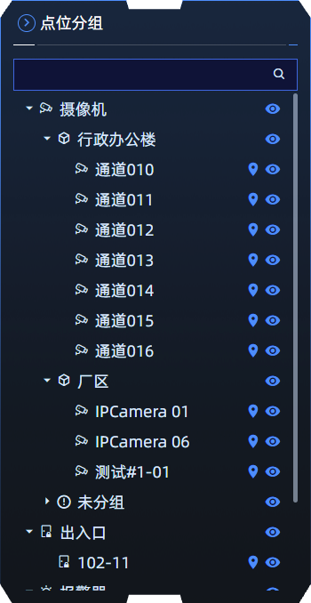

*图 9 点位分组面板*

**快捷操作**

| 图标 | 控件 | 作用 | 说明 |
| --- | --- | --- | --- |
| ◯▸ | 折叠箭头 | 收起/展开点位分组面板 | 为地图让出空间 |
| ↻ | 同步点位名称 | （仅管理员） | 把地图点位名称同步为绑定设备的名称，详见 3.3.5.1 |

**点位分组**

| 图标 | 控件 | 作用 | 说明 |
| --- | --- | --- | --- |
| 🔍 | 搜索框 | 按点位名称过滤树节点 | 输入后按回车或点击放大镜； 点击「×」清空并还原 |
| ▸ | 节点前的箭头 | 展开/收起该分组 | 区域节点可逐级展开 |
| 📍 | 定位 | 在地图上定位到该点位 | 点位被隐藏时不可操作； 定位会自动进入所在楼层 |
| 👁️ | 显示 | 当前为显示状态 | 点击后隐藏该点位； 分组上显示此图标表示该分组内还有点位显示，点击隐藏该分组下全部点位。 |
| 🚫 | 隐藏 | 当前为隐藏状态 | 点击后显示该点位； 分组上显示此图标表示该分组内点位全部隐藏，点击显示该分组下全部点位。 |

> **注1：** 隐藏的点位不在地图上显示。
>
> **注2：** 地图上有摄像机、但没有分组，会显示在「未分组」下。

**操作**

| 操作 | 作用 | 说明 |
| --- | --- | --- |
| 双击摄像机 | 播放该摄像机的实时视频 | 需要视频预览权限 |

##### 3.3.5.1 点位名称同步（仅管理员）

三维地图「点位分组」面板右上角的同步点位名称用于把地图点位名称同步为点位绑定设备的名称。

**操作步骤**

1. 在三维地图的「点位分组」面板右上角点击「同步点位名称」。
2. 在确认框点击「确定」。
3. 等待完成，系统会提示成功/失败数量；地图点位的名称更新为绑定设备的名称。

| 图标 | 控件 | 作用 | 说明 |
| --- | --- | --- | --- |
| ↻ | 同步点位名称 | 把地图点位名称同步为绑定设备的名称 | 点击后先弹框确认，确认后执行； 完成后提示成功/失败数量 |

### 3.4 报警弹窗

有新报警时，地图上对应点位会变为异常状态并闪烁，同时弹出报警联动视频窗口：

| 控件 | 作用 | 说明 |
| --- | --- | --- |
| 自动关闭 | 勾选后倒计时结束自动关闭弹窗 | 默认勾选，倒计时 30 秒； 取消勾选后弹窗保持显示 |
| 倒计时 | 显示剩余自动关闭时间 | 每次报警弹出时重新计时 |
| 视频画面 | 显示报警联动的摄像机实时画面 | 只显示当前账号有权限的摄像机 |

### 3.5 视频窗口

用于播放单路实时视频或录像回放：

| 图标 | 控件 | 作用 | 说明 |
| --- | --- | --- | --- |
| 🎥 | 预览 | 切换到实时预览 | 仅回放模式显示（需要预览权限） |
| ⏪ | 回放 | 切换到录像回放 | 仅预览模式显示（需要回放权限） |
|  | 日期 | 选择回放日期 | 点击输入框弹出日历，选择后自动填入（回放模式） |
|  | 时间范围 | 设置回放的开始时间和结束时间 | 可直接输入数字，或在数字上滚动鼠标滚轮调整（回放模式） |

## 四、视频播放

点击顶部「视频」图标 🎥，进入视频播放页。本章介绍播放器、视频预览、视频组和视频回放。

### 4.1 播放器

播放器用于显示视频画面，视频预览和视频回放共用同一个播放器。

| 图标 | 控件 | 作用 | 说明 |
| --- | --- | --- | --- |
| ⬜ | 单画面 | 切换为 1 画面 | 只保留当前选中的画面 |
| ▦ | 四画面 | 切换为 4 画面 | 从少画面切过来时，已播放的画面保持不变； 从多画面切过来时，只保留靠前的 4 个画面 |
| ▩ | 九画面 | 切换为 9 画面 | 从少画面切过来时，已播放的画面保持不变； 从多画面切过来时，只保留靠前的 9 个画面 |
| ▦ | 十六画面 | 切换为 16 画面 | 从少画面切过来时，已播放的画面保持不变 |
| ↕️ | 展开 | 放大播放器 | 收起左侧面板，播放器占满内容区 |
| ↕️ | 还原（展开后） | 恢复播放器 | 恢复左侧面板 |
| ⛶ | 全屏 | 全屏播放 | — |
| ⛶ | 还原（全屏后） | 退出全屏 | 按 Esc 或 F11 也可以退出 |

**操作**

| 操作 | 作用 | 说明 |
| --- | --- | --- |
| 单击画面窗口 | 选中该画面 | 选中的画面带高亮边框，双击左侧摄像机时会播放到该窗口 |

> **提示：** 码流自动切换：同时只有 1 路画面时使用主码流；同时播放多路画面时自动使用子码流，无需手动设置。关闭到只剩 1 路时会自动切回主码流。保存当前画面组合请使用「保存」（见 4.2.2）。

### 4.2 视频预览（需要视频预览权限）

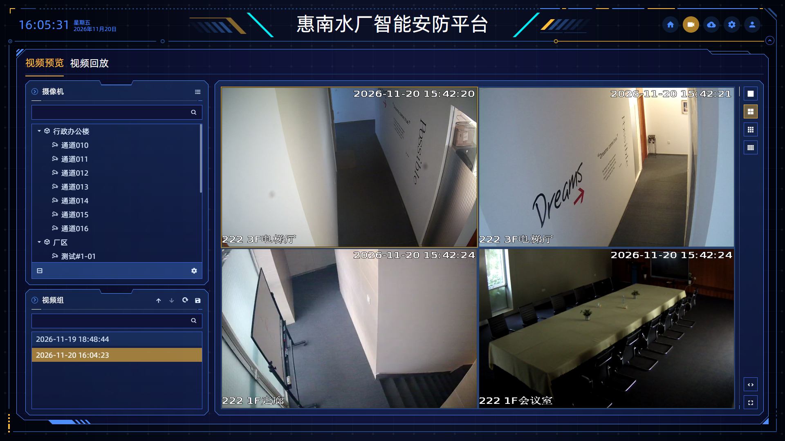

*图 12 视频预览*

**操作步骤**

1. 在左侧「摄像机」列表中找到摄像机。
2. 先单击一个画面窗口，选中要显示的位置。
3. 双击左侧摄像机，画面播放到选中的窗口。

#### 4.2.1「摄像机」列表面板

**快捷操作**

| 图标 | 控件 | 作用 | 说明 |
| --- | --- | --- | --- |
| ▸ | 折叠箭头 | 收起/展开摄像机列表面板 | 收起后下方视频组列表变大 |
| 🌳 | 多层 | 切换到按区域分组的树形列表 | 只显示有摄像机的区域 |
| ☰ | 列表 | 切换到平铺的摄像机列表 | — |

**摄像机列表**

| 图标 | 控件 | 作用 | 说明 |
| --- | --- | --- | --- |
| 🔍 | 搜索框 | 按名称查找摄像机 | 点击放大镜查询，点击「×」清空并还原 |
| ▸ | 区域节点前的箭头 | 展开/收起区域 | 多层模式下使用 |
| ⊟ | 全部折叠 | 收起所有区域 | 多层模式下使用 |
| ⚙️ | 配置区域资源 | 打开区域资源配置窗口 | 仅管理员（同「区域资源设置」功能） |

**操作**

| 操作 | 作用 | 说明 |
| --- | --- | --- |
| 双击摄像机 | 播放该摄像机 | 播放到当前选中的画面窗口 |

#### 4.2.2 视频组

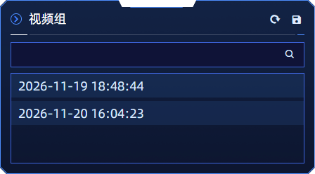

*图 13 视频组*

视频组用于保存常用的多画面组合，值守时可一次调出整组画面。把当前正在播放的画面组合保存为视频组，使用「保存」。

**操作步骤**

1. 在右侧播放器播放需要的画面（1/4/9/16 画面），并排列好窗口。
2. 点击「保存」；有画面在播放时才可操作。
3. 保存成功后，视频组列表新增一条以当前时间命名的记录；点击铅笔图标可以改名。
4. 双击视频组详情或点击播放即可整组播放；点击循环可按列表顺序轮播所有视频组。

**快捷操作**

| 图标 | 控件 | 作用 | 说明 |
| --- | --- | --- | --- |
| ▸ | 折叠箭头 | 收起/展开视频组面板 | — |
| ↑ | 排序前移 | 把选中的视频组向前移动一位 | 选中视频组且列表有多项时可用 |
| ↓ | 排序后移 | 把选中的视频组向后移动一位 | — |
| 🔄 | 顺序播放 | 按列表顺序循环播放所有视频组 | 列表中有视频组时才显示； 再次点击停止，按钮高亮表示正在循环 |
| 💾 | 保存 | 把当前正在播放的画面组合保存为一个视频组 | 默认以当前时间命名，有画面在播放时才可操作 |

**视频组列表**

鼠标移到视频组详情上，右侧会显示播放、改名、删除按钮：

*图 13-1 视频组列表项（鼠标悬停时显示操作按钮）*

| 图标 | 控件 | 作用 | 说明 |
| --- | --- | --- | --- |
| 🔍 | 搜索框 | 按名称查找视频组 | 点击放大镜查询，点击「×」清空并还原 |
| ▶️ | 播放视频组 | 播放该视频组 | 同双击 |
| ✏️ | 修改视频组名称 | 把名称变成输入框 | 修改后点「√」保存，点「×」取消 |
| 🗑️ | 删除视频组 | 删除该视频组 | 弹出确认框，点「确定」删除、「取消」放弃 |

点击铅笔图标修改名称：名称变成输入框后，点「√」保存，点「×」取消。

*图 13-2 修改视频组名称*

**操作**

| 操作 | 作用 | 说明 |
| --- | --- | --- |
| 双击视频组 | 播放整组画面 | 按保存时的画面数自动切换布局 |

### 4.3 视频回放（需要视频回放权限）

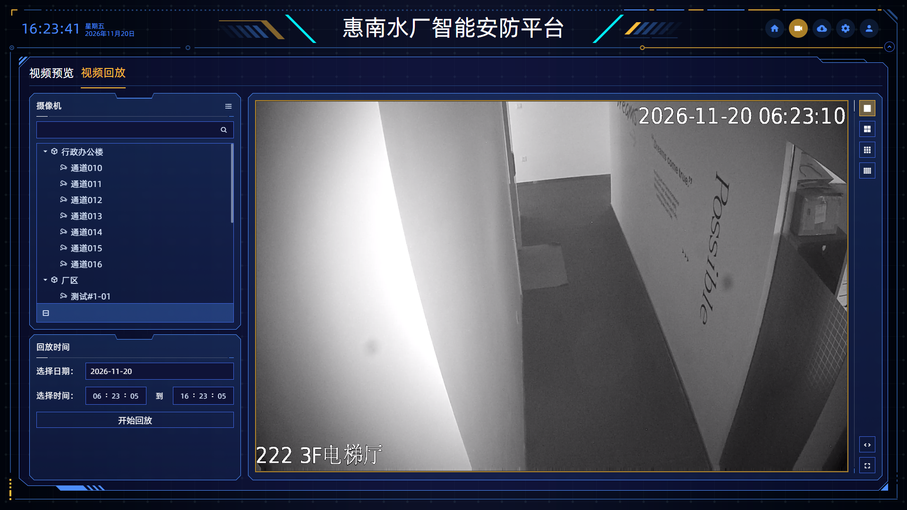

*图 14 视频回放*

**操作步骤**

1. 切换到「视频回放」。
2. 在左侧「摄像机」列表中选择要回放的摄像机（单击选中）。
3. 在「回放时间」卡片中选择日期。
4. 设置「选择时间」的开始时间和结束时间。
5. 点击「开始回放」。

| 控件 | 作用 | 说明 |
| --- | --- | --- |
| 选择日期 | 选择回放日期 | 点击输入框弹出日历，选择某一天后自动填入 |
| 选择时间 | 设置回放开始和结束时间 | 分别输入时、分、秒； 可直接输入数字，也可在数字上滚动鼠标滚轮增减； 开始时间不能晚于结束时间，超出会自动收敛 |
| 开始回放 | 播放所选时段录像 | 需要回放权限 |

## 五、视频下载（需要视频下载权限）

点击顶部「下载」图标 ⬇️，会打开一个新的视频下载页面。

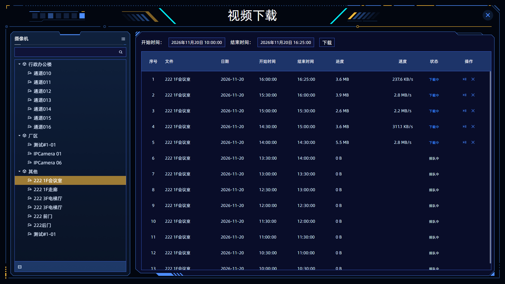

*图 15 视频下载*

**操作步骤**

1. 在左侧选择要下载的摄像机。
2. 设置开始时间和结束时间。
3. 点击「下载」。
4. 在下方下载任务列表查看进度；下载完成前不要关闭或刷新页面。

| 控件 | 作用 | 说明 |
| --- | --- | --- |
| 开始时间 | 设置下载片段的开始时间 | 点击输入框选择日期和时间，精确到小时 |
| 结束时间 | 设置下载片段的结束时间 | 默认是最近 30 分钟； 结束时间需晚于开始时间 |
| 下载 | 创建下载任务 | 选择摄像机并设置合法时间后才可操作 |

### 5.1 下载任务状态说明

| 状态 | 可执行的操作 | 说明 |
| --- | --- | --- |
| 排队中 | 等待自动开始 | 同时下载数达到上限时会排队 |
| 下载中 | 暂停、取消 | 「暂停」保留已下载的进度，点「开始」从断点继续； 「取消」停止并删除任务 |
| 已暂停 | 开始、取消 | 「开始」继续下载 |
| 保存中 | 等待完成 | 下载完成后写入文件 |
| 已完成 | 重新下载、删除 | 「重新下载」重新发起同一时间段的任务 |
| 失败 | 重试、删除 | 状态列会显示失败原因，可点「重试」重新下载 |

> **提示：** 同时下载的任务数量有上限（1～5 个，由管理员在「设置 → 系统设置 → 下载设置」中配置），达到上限后新任务会排队等待。

> **注：** 超过 30 分钟的录像会按 30 分钟拆成多个下载任务，任务列表会出现多条，属于正常现象；下载任务在当前页面内完成，下载完成前请不要关闭或刷新页面，否则未完成的任务会中断。如果浏览器提示是否允许下载多个文件，请选择允许。

### 5.2 下载文件名称

下载完成后，文件名由「摄像机名称 + 录像时间段 + .mp4」组成，格式为：

**摄像机名称_开始时间_结束时间.mp4**

- 摄像机名称：左侧选中的摄像机名称，与下载任务列表中的名称一致；
- 开始时间、结束时间：这段录像的起止时间，按「年月日时分秒」连写，如 20261123140000 表示 2026 年 11 月 23 日 14:00:00；
- .mp4：视频文件格式。

示例：摄像机「1号门摄像机」下载 2026 年 11 月 23 日 14:00:00 至 14:30:00 的录像，文件名为：

**1号门摄像机_20261123140000_20261123143000.mp4**

时间范围超过 30 分钟时会拆成多个文件，每个文件只包含一段录像，文件名中的时间段就是这一段的时间。例如下载 14:00:00 至 14:40:00，会得到两个文件：

- 1号门摄像机_20261123140000_20261123143000.mp4（14:00—14:30）
- 1号门摄像机_20261123143000_20261123144000.mp4（14:30—14:40）

## 六、设置

点击顶部「设置」图标 ⚙️，进入设置页，可以在「系统设置」「地图布控」「区域资源设置」之间切换。

### 6.1 系统设置

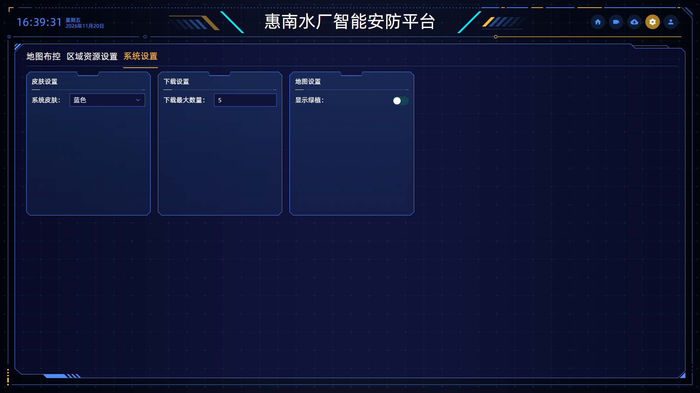

*图 16 系统设置*

**皮肤设置**

| 控件 | 作用 | 说明 |
| --- | --- | --- |
| 系统皮肤 | 切换系统配色 | 可选绿色、蓝色。 |

**下载设置（需要下载权限）**

| 控件 | 作用 | 说明 |
| --- | --- | --- |
| 下载最大数量 | 设置同时下载的最大任务数 | 范围 1～5； 可直接输入或在数字上滚动滚轮调整 |

**地图设置**

| 控件 | 作用 | 说明 |
| --- | --- | --- |
| 显示绿植 | 控制三维地图中是否显示树木绿植 | 打开/关闭后地图刷新显示 |

### 6.2 地图布控（仅管理员）

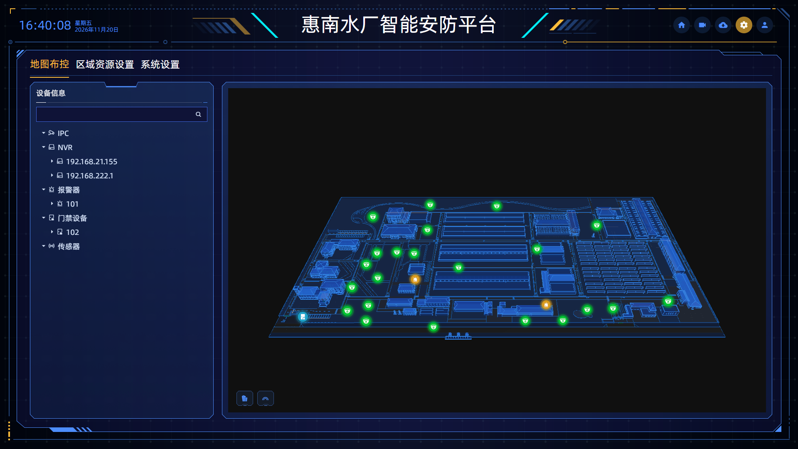

*图 17 地图布控*

用于把设备绑定到三维地图上、解除绑定或调整位置。

如果服务器还没有地图数据，进入地图布控时会自动创建：按厂区模型创建一张地图，并把模型里的建筑、楼层同步生成为地图点位。创建完成后会提示「初始化完成，请刷新界面」，5 秒后自动刷新，等页面刷新完成后再操作。

#### 6.2.1 操作步骤

1. 在左侧「设备信息」中找到要绑定的设备。
2. 点击设备后面的「绑定」 🔗。
3. 在地图上把鼠标移动到目标位置，单击左键放置点位；不想绑定时单击右键取消。
4. 绑定成功后，主页地图上即可看到该设备点位。

**解除绑定**

1. 在左侧「设备信息」中找到已绑定的设备。
2. 点击设备后面的「解绑」 🔗。
3. 在确认框点击「确定」；地图上对应点位随即消失。

**调整摄像机视野**

1. 点击「摄像机视野」，地图上显示摄像机的视野扇形。
2. 单击要调整的摄像机点位，拖动扇形边缘的角点调整半径和角度，拖动弧中点旋转朝向。
3. 调整后自动保存；再次点击「摄像机视野」可隐藏视野。

#### 6.2.2 设备信息

| 图标 | 控件 | 作用 | 说明 |
| --- | --- | --- | --- |
| 🔍 | 搜索框 | 按名称查找设备 | 点击放大镜查询，点击「×」清空并还原 |
| ▸ | 节点前箭头 | 展开/收起设备和下级 | — |
| 📍 | 定位 | 在地图上定位到该设备已绑定的点位 | 未绑定的设备没有定位按钮 |
| 🔗 | 绑定 | 进入绑定状态 | 鼠标移到地图上会跟随一个半透明图标，在目标位置单击左键完成绑定； 单击右键取消 |
| 🔗 | 解绑 | 解除设备与地图点位的绑定 | 弹出确认框，点「确定」解绑、「取消」放弃 |

#### 6.2.3 三维地图

**地图操作**

- 建筑列表：点击左下角的「建筑列表」 🏢，显示厂区内所有建筑名称；再点一次收起列表，与主页地图一致。
- 单击建筑名称：定位并聚焦该建筑。
- 双击建筑名称：展开建筑，显示楼层按钮。
- 双击点位：在左侧「设备信息」中定位对应设备；没有绑定设备的点位会提示是否删除。

展开建筑后，左下角显示楼层按钮和「返回」：

- 楼层按钮：切换楼层，当前楼层高亮。
- 返回：从楼层回到厂区视角。

**摄像机视野**

- 摄像机视野：点击左下角的「摄像机视野」 👁️ 显示摄像机的监控视野，再点一次隐藏；按钮高亮表示正在显示，用于核对点位朝向。
- 调整视野：拖动摄像机点位的扇形手柄，拖动扇形边缘的角点调整半径和角度，拖动弧中点旋转朝向；调整后自动保存。

### 6.3 区域资源设置（仅管理员）

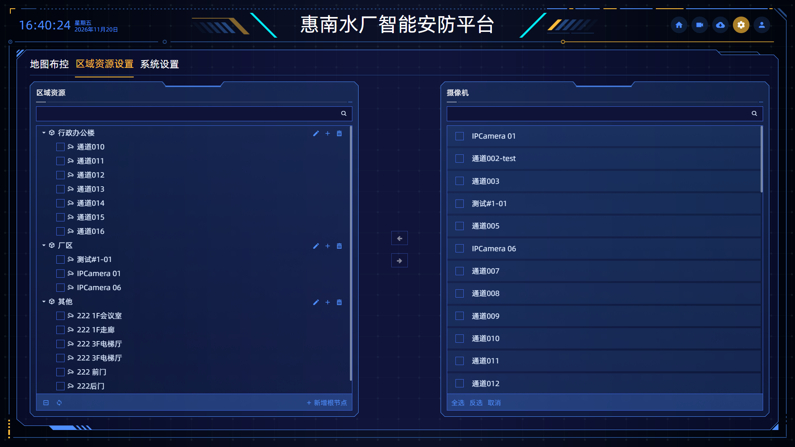

*图 18 区域资源设置*

用于维护「区域资源」树，并把摄像机分配到各区域。视频播放页中的摄像机分组、地图右侧的点位分组都按这里配置的区域显示。

**操作步骤**

1. 新增区域：在左侧树中选中上级区域，点击「添加」＋，输入名称后点「√」；新增顶层区域点树底部的「新增根节点」。
2. 重命名/删除：点节点后的铅笔/垃圾桶图标，按提示保存或确认；保存后立即生效。
3. 分配摄像机：在右侧列表勾选摄像机 → 在左侧选中或勾选目标区域 → 点左箭头「导入」。
4. 移出摄像机：在左侧勾选要移出的资源（或选中区域）→ 点右箭头「导出」，资源回到右侧摄像机列表。
5. 批量选择：右侧可用「全选」「反选」「取消」；鼠标悬停在摄像机详情上可查看所属设备名称和视频名称。
6. 名称同步、全部折叠等操作见下面的按钮说明。

#### 6.3.1 区域资源

**搜索区域资源**

| 图标 | 控件 | 作用 | 说明 |
| --- | --- | --- | --- |
| 🔍 | 搜索框 | 按名称查找区域或资源 | 点击放大镜查询，点击「×」清空并还原 |

**节点操作**

| 图标 | 控件 | 作用 | 说明 |
| --- | --- | --- | --- |
| ▸ | 节点前箭头 | 展开/收起子节点 | — |
| ✏️ | 修改 | 把节点名称变成输入框 | 修改后点「√」保存，点「×」取消； 保存后立即生效 |
| ＋ | 添加 | 在该节点下新增子节点 | 输入名称后点「√」保存，点「×」取消 |
| 🗑️ | 删除 | 删除该节点 | 弹出确认框，点「确定」删除、「取消」放弃 |
| ☐ | 节点复选框 | 多选资源 | 用于一次移出多个摄像机（导出） |

**树操作**

| 图标 | 控件 | 作用 | 说明 |
| --- | --- | --- | --- |
| ⊟ | 全部折叠 | 收起所有节点 | — |
| ↻ | 同步摄像机名称 | 用摄像机名称统一更新区域资源名称 | 弹出确认框； 完成后提示成功/失败数量 |
| ＋ | 新增根节点 | 在树的最下方新增顶层区域 | 输入名称后保存 |

#### 6.3.2 摄像机列表

| 图标 | 控件 | 作用 | 说明 |
| --- | --- | --- | --- |
| 🔍 | 搜索框 | 按名称查找摄像机 | 点击放大镜查询，点击「×」清空并还原 |
| ☐ | 摄像机复选框 | 勾选要分配的摄像机 | 可多选 |
| ☑️ | 全选 | 勾选列表中全部摄像机 | — |
| ☐ | 反选 | 勾选状态反转 | — |
| ✖ | 取消 | 清空所有勾选 | — |

**操作**

| 操作 | 作用 | 说明 |
| --- | --- | --- |
| 鼠标悬停摄像机详情 | 显示所属设备名称和视频名称 | 方便区分同名视频 |

#### 6.3.3 摄像机分配

| 图标 | 控件 | 作用 | 说明 |
| --- | --- | --- | --- |
| ⬅️ | 左箭头「导入」 | 把右侧勾选的摄像机分配到左侧选中/勾选的区域 | 左侧必须选中一个区域节点； 成功后右侧列表减少、左侧出现该摄像机 |
| ➡️ | 右箭头「导出」 | 把左侧勾选（或选中）的摄像机移出所在区域 | 资源节点回到右侧摄像机列表 |

> **提示：** 区域资源的增删改、摄像机导入/导出都是保存后立即生效。

## 七、常见问题

### 1. 登录提示「用户名或密码错误」？

确认账号、密码大小写及输入法状态；仍无法登录请联系系统管理员重置密码。

### 2. 看不到「下载」「视频回放」入口或按钮不可操作？

说明当前账号没有对应权限，请联系系统管理员开通。

### 3. 有摄像机名称，但无法播放视频？

先确认摄像机是否在线（地图上显示为异常），以及账号是否拥有视频预览权限。视频预览页双击摄像机时，画面会播放到当前选中的画面窗口；想换窗口显示，先单击目标画面，再双击摄像机。

### 4. 地图上看不到某个设备点位？

可能是设备未绑定点位、没有视频权限，或所在楼层未展开。可先在右侧「点位分组」中搜索该设备；仍找不到请联系管理员在「地图布控」中检查绑定关系。

### 5. 三维地图加载慢、无法显示或显示异常？

三维地图首次加载需要下载模型，请耐心等待；建议使用 Chrome 或 Edge 浏览器，并确保网络畅通。页面长时间无响应时可刷新页面重试。

如果页面提示「三维地图无法显示」，说明当前浏览器无法使用 WebGL（三维地图需要它才能显示）：请在浏览器设置中开启「使用硬件加速」并重启浏览器；如果电脑由公司统一管理，请联系管理员开启 WebGL。

### 6. 页面提示「实时消息服务连接失败」？

该提示表示报警和设备状态可能无法实时刷新。请检查这台电脑的网络是否正常，系统会自动重连；长时间未恢复请联系管理员检查服务器。

### 7. 下载任务一直「排队中」？

同时下载任务数已达到上限，等待前面的任务完成或暂停后会自动开始；也可以在「设置 → 系统设置 → 下载设置」中调整最大数量（需要下载权限）。

---

*惠南水厂智能安防平台 使用说明 V1.6*
